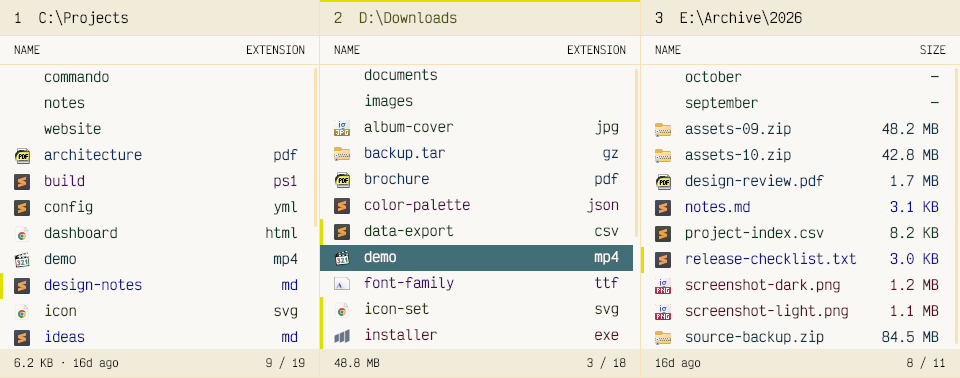

  <picture>
    <source media="(prefers-color-scheme: dark)" srcset="site/assets/logo-dark.svg">
    
  </picture>

  <h1>Commando</h1>

  
<strong>The file terminal for power users with mouse issues.</strong>

  
A multi-panel file manager for Windows, built for keyboard control and a workspace you can make your own.

  
<a href="https://commando.sector-seven.com/">Explore features</a> · <a href="https://github.com/DannyBen/commando/releases/latest">Download the latest release</a>

  <picture>
    <source media="(prefers-color-scheme: dark)" srcset="site/assets/overview-dark.png">
    
  </picture>

