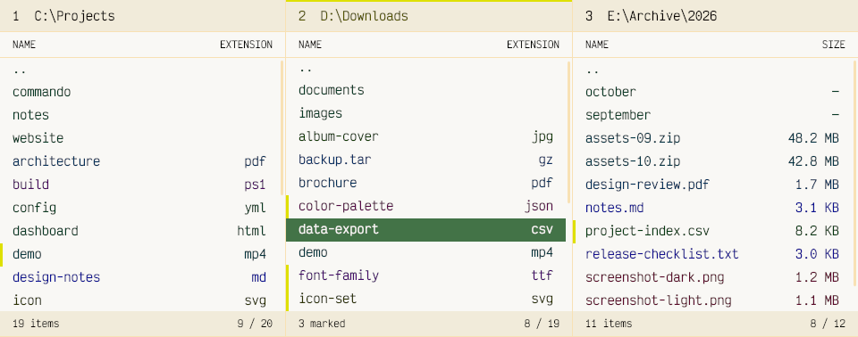
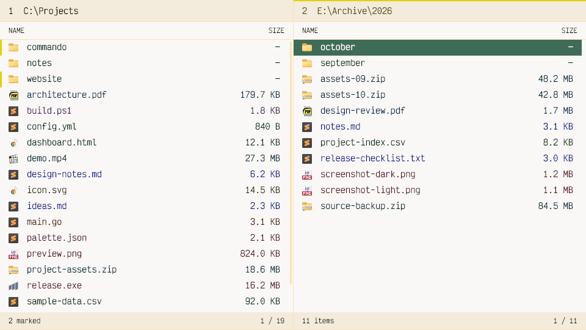
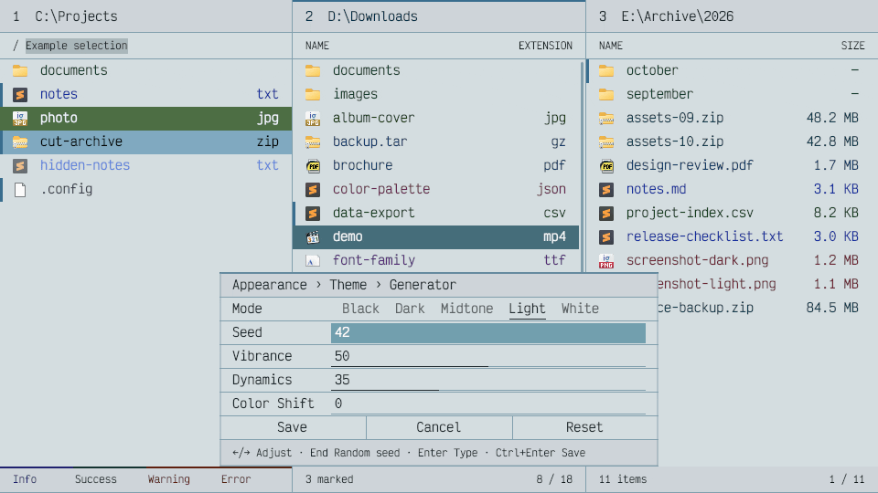
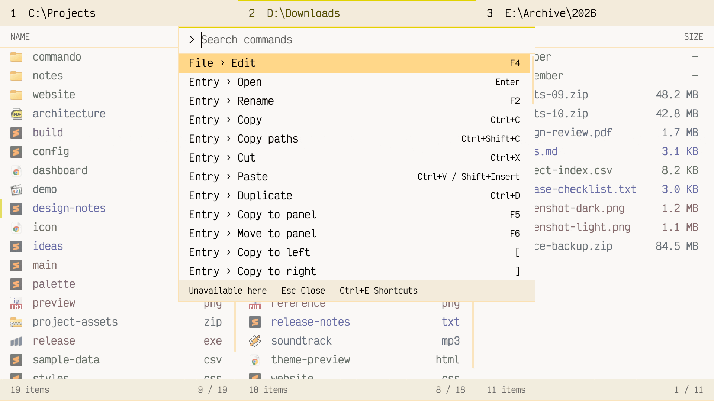

  <picture>
    <source media="(prefers-color-scheme: dark)" srcset="support/readme/dark/logo.svg">
    <source media="(prefers-color-scheme: light)" srcset="support/readme/light/logo.svg">
    
  </picture>

  <h1>Commando</h1>

  
<strong>The file terminal for power users with mouse issues.</strong>

  
Commando is a multi-panel file manager for Windows, with obsessive keyboard support, shortcuts you can actually discover, and a workspace you can make your own.

  
<strong><a href="https://github.com/DannyBen/commando/releases">Download Commando for Windows</a></strong>

  

  <picture>
    <source media="(prefers-color-scheme: dark)" srcset="support/readme/dark/overview.png">
    <source media="(prefers-color-scheme: light)" srcset="support/readme/light/overview.png">
    
  </picture>

## Multi-panel. Because two is never enough.

  <picture>
    <source media="(prefers-color-scheme: dark)" srcset="support/readme/dark/panels.gif">
    <source media="(prefers-color-scheme: light)" srcset="support/readme/light/panels.gif">
    
  </picture>

Open several folders side by side, each with its own selection, marks, and view.
Dense file lists and compact metadata keep the focus on files, with no icons or
tile views.

## Themes. More themes!

  <picture>
    <source media="(prefers-color-scheme: dark)" srcset="support/readme/dark/themes.gif">
    <source media="(prefers-color-scheme: light)" srcset="support/readme/light/themes.gif">
    
  </picture>

Generate new palettes effortlessly, from quiet neutrals to unapologetic color.
Tune the result live, then make the rest yours with fonts, spacing, and file-type
colors.

## Keyboard first. Mouse: strictly optional.

  <picture>
    <source media="(prefers-color-scheme: dark)" srcset="support/readme/dark/commands.gif">
    <source media="(prefers-color-scheme: light)" srcset="support/readme/light/commands.gif">
    
  </picture>

Navigation, selection, filtering, and file operations all work from the keyboard.
The command palette puts actions, settings, and shortcut customization in one
searchable place—part command launcher, part help, all within reach.

---

